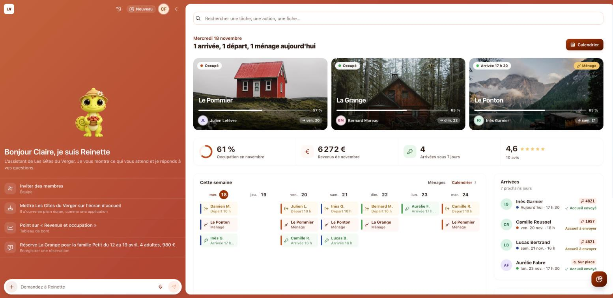
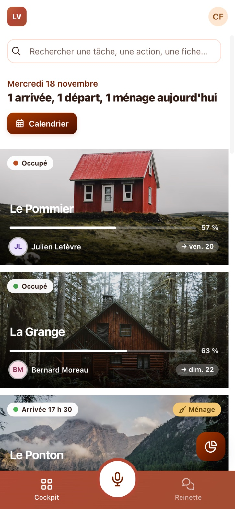
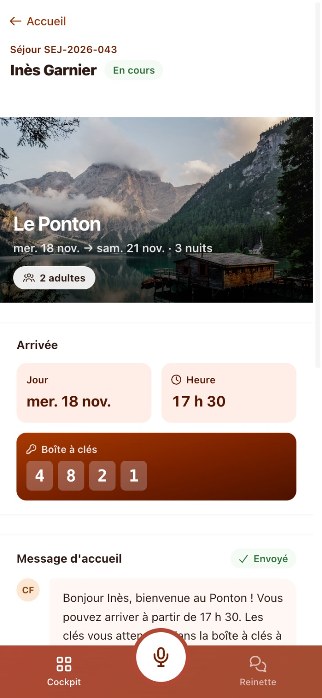
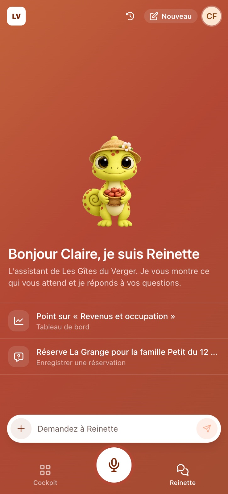
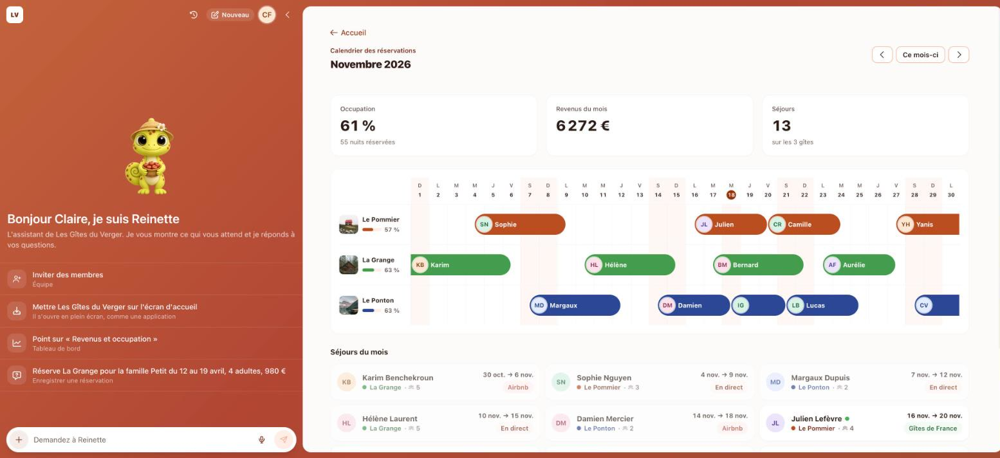

# Construire son cockpit InProcess avec Claude

Décrivez votre activité à Claude, il construit votre **cockpit** : votre outil de travail sur mesure, avec son
assistant, sur ordinateur et sur téléphone.

<p align="center">
  <a href="https://github.com/inprocess-ai/claude-cockpit/releases/latest/download/claude-cockpit.zip">
    
  </a>
</p>



## Démarrer

1. **Téléchargez** [claude-cockpit.zip](https://github.com/inprocess-ai/claude-cockpit/releases/latest/download/claude-cockpit.zip) et décompressez-le.
2. **Ouvrez le dossier dans Claude Code** (application Claude, onglet **Code**), et acceptez le serveur **InProcess**.
3. **Tapez** `/cockpit` suivi de ce que vous voulez mieux suivre, par exemple :

   ```
   /cockpit Je loue 3 gîtes : je veux voir les arrivées, le ménage entre deux séjours et les avis des voyageurs
   ```

   ```
   /cockpit Je donne des cours de yoga : les inscriptions, le planning des cours et qui a payé
   ```

La première fois, Claude vous demande de connecter InProcess : un compte gratuit, une seule fois.

<table>
  <tr>
    <td width="33%"></td>
    <td width="33%"></td>
    <td width="33%"></td>
  </tr>
</table>



## Comment ça marche

Le dossier branche Claude au connecteur MCP d'InProcess, `https://studio.inprocess.ai/mcp` (voir [`.mcp.json`](.mcp.json)).
Votre abonnement Claude construit le cockpit ; son code vit chez InProcess. Claude vous donne un lien pour l'essayer, et
le met en ligne pour votre équipe **seulement avec votre accord**. Il ne paie jamais à votre place et ne voit pas les
données de votre cockpit en ligne.

Sans Claude Code (claude.ai ou discussion de l'application Claude) : ajoutez `https://studio.inprocess.ai/mcp` dans
**Réglages › Connecteurs**, puis demandez à Claude de construire votre cockpit.

Une question : contact@inprocess.ai · [inprocess.ai](https://www.inprocess.ai)
